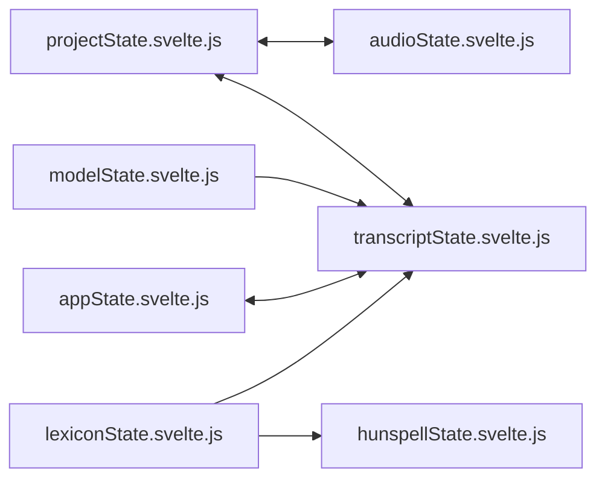

# Source Code Architecture & File Reference (`src/`)

This document provides a comprehensive overview of the `src/` directory in **EasperWeb**, detailing what each file does and how modules, reactive states, services, UI components, and Web Workers connect.

---

## 1. High-Level System Architecture

EasperWeb is built on **Svelte 5** (using universal reactivity runes `$state`, `$derived`, `$effect` in `.svelte.js` modules) and offloads heavy machine learning and audio inference (Whisper, Whistle, Silero VAD, PyAnnote Segmentation 3.0, and 3D-Speaker CAM++) to a dedicated **Web Worker** (`src/worker.js`).

```mermaid
flowchart TD
    subgraph UI["UI Layer (Svelte 5 Pages & Components)"]
        App["src/App.svelte"]
        Pages["src/pages/*.svelte<br/>(Home, Transcriber, Dataset, Models, Lexicons, Guide, WhatsNew)"]
        Components["src/components/**/*.svelte<br/>(Main, Project, Dataset, Lexicon, Home, Common)"]
    end

    subgraph State["Reactive State Layer (src/state/*.svelte.js)"]
        AppState["appState.svelte.js"]
        ProjectState["projectState.svelte.js"]
        AudioState["audioState.svelte.js"]
        TranscriptState["transcriptState.svelte.js"]
        ModelState["modelState.svelte.js"]
        DatasetState["datasetState.svelte.js"]
        LexiconState["lexiconState.svelte.js"]
        HunspellState["hunspellState.svelte.js"]
    end

    subgraph ServicesAndUtils["Services, Rendering & Utilities"]
        Router["src/services/router.svelte.js"]
        DB["src/services/db.js (IndexedDB easper_db v3)"]
        HunspellSvc["src/services/hunspellService.js (hunspell-asm WASM)"]
        Renderer["src/rendering/waveformCanvasRenderer.js"]
        AudioCore["src/audio.js"]
        ElanCore["src/elan.js & src/utils/elan*.js"]
        DomainUtils["src/utils/*.js (subTiers, speakers, autoTagging, dataset*, etc.)"]
    end

    subgraph WorkerThread["Inference Web Worker Thread"]
        Worker["src/worker.js"]
        VAD["src/vad.js (Silero VAD v5)"]
        Diarizer["src/diarizer.js (3D-Speaker CAM++)"]
        PyAnnote["src/pyannote.js (PyAnnote 3.0)"]
        FBank["src/utils/fbank.js & diarization.js"]
        Whistle["src/utils/whistleRunner.js (Cactus Needle WASM)"]
    end

    App --> Router
    App --> Pages
    Pages --> Components
    Components --> State
    App <-->|"postMessage / onmessage"| Worker

    TranscriptState --> Renderer
    TranscriptState --> ElanCore
    TranscriptState --> AudioCore
    TranscriptState --> DomainUtils
    ProjectState --> DB
    ModelState --> DB
    LexiconState --> DB
    LexiconState --> HunspellState
    HunspellState --> HunspellSvc
    DatasetState --> ElanCore
    DatasetState --> AudioCore
    DatasetState --> DomainUtils

    Worker --> VAD
    Worker --> Diarizer
    Worker --> PyAnnote
    Worker --> Whistle
    Diarizer --> FBank
    PyAnnote --> Diarizer
    PyAnnote --> FBank
```

---

## 2. Root Entry Points, Audio & ML Engines (`src/`)

Files at the root of `src/` bootstrap the application, handle low-level WAV audio decoding/resampling, generate ELAN XML, and run the Web Worker ML pipelines.

| File | Purpose & Connections |
| :--- | :--- |
| [`src/main.js`](../src/main.js) | Application entry point. Mounts [`App.svelte`](../src/App.svelte) to `#app`, imports global styles (`app.css`), and registers the PWA Service Worker (`virtual:pwa-register`). |
| [`src/App.svelte`](../src/App.svelte) | Root shell component. Initializes the ML Web Worker (`src/worker.js`), dispatches worker messages via `WORKER_MESSAGE_HANDLERS` to reactive stores (`appState`, `modelState`, `transcriptState`, `projectState`), renders the active page from `router.path`, and hosts global modals (`ProjectManagerModal`, `NewProjectModal`, `ProjectSettingsModal`, `ElanImportModal`, `SegmentWarningModal`). |
| [`src/app.css`](../src/app.css) | Global stylesheet defining CSS custom properties (light/dark themes, typography, layout grids, and shared UI utility classes). |
| [`src/config.js`](../src/config.js) | Defines the default Hugging Face Hub ASR model ID constant (`MODEL_ID = 'onnx-community/whisper-small'`). |
| [`src/audio.js`](../src/audio.js) | Client-side audio processing toolkit: fast 4 KB RIFF/WAVE header inspection (`parseWavInfo`), decoding and resampling arbitrary audio files to 16 kHz mono (`processAudioFile`), encoding `Float32Array` PCM to 16-bit WAV Blobs (`encodeWavBlob`), and extracting min/max waveform peaks (`extractWaveformPeaks`). Used by `audioState`, `transcriptState`, `datasetState`, and `datasetBuilder`. |
| [`src/elan.js`](../src/elan.js) | ELAN (`.eaf` v2.8/3.0) XML generator (`ElanEaf` class and `exportToEaf` function). Exports multi-speaker root tiers, `Symbolic_Subdivision` or `Time_Subdivision` word/morpheme sub-tiers directly under speaker tiers, `Symbolic_Association` sentence sub-tiers, and `ANNOTATOR` metadata. Used by `transcriptState`. |
| [`src/worker.js`](../src/worker.js) | Dedicated Web Worker coordinating all neural inference off the main UI thread: Whisper (`@huggingface/transformers` on WebGPU or multi-threaded WASM SIMD), Whistle (`whistleRunner.js`), local folder model virtual caching (`LocalFolderCache`), Silero VAD (`vad.js`), CAM++ speaker embeddings (`diarizer.js`), and PyAnnote Segmentation (`pyannote.js`). Communicates with `App.svelte` and `transcriptState`. |
| [`src/vad.js`](../src/vad.js) | Silero VAD v5 ONNX engine (~2.2 MB). Configures `onnxruntime-web` WASM paths, caches the model in `CacheStorage` (`silero-vad-cache-v1`), runs frame-by-frame voice activity detection (`getSpeechTimestamps`), tightens existing segment boundaries (`trimSegmentsWithVad`), and cleans/merges speech intervals (`segmentsCleanup`). Called by `worker.js`. |
| [`src/diarizer.js`](../src/diarizer.js) | 3D-Speaker CAM++ ONNX inference engine (`public/spkrec_ecapa.onnx`, 512-d speaker embeddings). Computes Kaldi 80-channel Mel-filterbanks via `src/utils/fbank.js` and returns L2-normalized embedding vectors. Called by `worker.js` and `pyannote.js`. |
| [`src/pyannote.js`](../src/pyannote.js) | Hybrid PyAnnote Segmentation 3.0 engine (`onnx-community/pyannote-segmentation-3.0`, ~5.8 MB SincNet + BiLSTM). Detects frame-level turn-taking (17 ms resolution), intra-segment speaker changes, and overlapping speech, then pairs with `diarizer.js` and `utils/diarization.js` for global speaker clustering. Called by `worker.js`. |

---

## 3. Reactive State Layer (`src/state/*.svelte.js`)

EasperWeb uses Svelte 5 singleton state classes in `src/state/` to share reactive state across components without prop drilling.

| File | Purpose & Connections |
| :--- | :--- |
| [`src/state/appState.svelte.js`](../src/state/appState.svelte.js) | Global UI & runtime status store: processing flags (`isProcessing`, `processingMode`), status bar messages, download progress bars, theme toggle (dark/light), worker reference (`worker`), and help-text visibility. |
| [`src/state/projectState.svelte.js`](../src/state/projectState.svelte.js) | Manages transcription projects in IndexedDB (`db.js`): creating, loading, auto-saving, renaming, and deleting projects, plus project-level metadata (`speakers`, `subTiers`, `mainTierTitle`, `transcriber`, `activeLexiconId`, `elanSubdivisionStereotype`). Synchronizes with `transcriptState` and `audioState`. |
| [`src/state/audioState.svelte.js`](../src/state/audioState.svelte.js) | Manages active audio playback and recording: HTML5 `<audio>` element binding, play/pause/seek, playback speed (`0.5x–1.5x`), decoded 16 kHz `Float32Array` buffer, active time-interval selection (`audioRangeStart`, `audioRangeEnd`), and microphone recording. |
| [`src/state/transcriptState.svelte.js`](../src/state/transcriptState.svelte.js) | Central coordinator for the Transcriber Studio: dialogue `segments`, undo/redo history stacks, VAD & diarization parameters (`VAD_DEFAULTS`), vertical waveform zoom & viewport scrolling (pivoting around the vertical center of the view frame), worker command dispatch (VAD, diarization, full/segment/interval ASR), sub-tier editing, validation issues, and exports (`.eaf`, `.srt`, `.txt`, `.json`, `.wav`). |
| [`src/state/modelState.svelte.js`](../src/state/modelState.svelte.js) | Manages ASR model presets (`Whistle`, `Whisper-base`, `Whisper-small`), custom Hugging Face Hub models, and local folder models stored in IndexedDB (`db.js`). Tracks CacheStorage offline status, compute device selection (`auto`, `webgpu`, `wasm`), and target transcription language. |
| [`src/state/datasetState.svelte.js`](../src/state/datasetState.svelte.js) | Drives the 7-step Dataset Builder wizard: `.eaf` and audio file ingestion & pairing (`MAX_DATASET_PAIRS = 50`), tier selection, character inventory & whitelist filtering, validation issue scanning, regex/literal replacement rules (`localStorage`), train/val/test split calculation, and `.zip` dataset archive export. |
| [`src/state/lexiconState.svelte.js`](../src/state/lexiconState.svelte.js) | Manages user lexicons stored in IndexedDB (`db.js`): lexicon CRUD, customizable field schemas (with mandatory `Headword`), entry search/filtering, and `.tsv` dictionary import/export. Triggers `hunspellState` dictionary rebuilds when entries change. |
| [`src/state/hunspellState.svelte.js`](../src/state/hunspellState.svelte.js) | Reactive wrapper around [`hunspellService.js`](../src/services/hunspellService.js). Tracks spellchecker readiness, active lexicon binding, custom `.aff` affix rules, and exposes reactive `checkWord()` / `suggest()` helpers to `SegmentCard.svelte`. |

---

## 4. Services & Rendering (`src/services/`, `src/rendering/`)

| File | Purpose & Connections |
| :--- | :--- |
| [`src/services/db.js`](../src/services/db.js) | Native Promise-based IndexedDB wrapper (`easper_db` v3) managing 5 object stores: `projects`, `audio` (16 kHz WAV blobs), `asr_models`, `asr_model_files`, and `lexicons`. Used by `projectState`, `modelState`, `lexiconState`, and `transcriptState`. |
| [`src/services/router.svelte.js`](../src/services/router.svelte.js) | Reactive client-side router supporting History API paths (`/`, `/transcriber`, `/dataset`, `/models`, `/lexicons`, `/guide`, `/whats-new`) and GitHub Pages base-path resolution. |
| [`src/services/hunspellService.js`](../src/services/hunspellService.js) | WebAssembly Hunspell engine (`hunspell-asm`). Dynamically compiles lexicon headwords into virtual `.dic` and `.aff` files mounted in WASM memory for real-time spellchecking and suggestions. |
| [`src/services/whisperLanguages.js`](../src/services/whisperLanguages.js) | Complete mapping of ISO language codes and language names supported by OpenAI Whisper models, plus lookup helpers (`getLanguageName`). |
| [`src/services/whistleLanguages.js`](../src/services/whistleLanguages.js) | Supported language codes (`auto`, `en`, `de`, `fr`, `es`, `it`, `nl`, `pl`) and lookup helpers for the Whistle (`Cactus-Compute/whistle`) ASR model. |
| [`src/rendering/waveformCanvasRenderer.js`](../src/rendering/waveformCanvasRenderer.js) | High-performance 2D Canvas renderer for the vertical waveform timeline. Implements tiled offscreen canvas caching (`getTileCanvas`, `drawTile`), ruler tick marks, silence-gap shading, selection interval overlays (`drawVerticalWaveform`), and 60 FPS playhead rendering (`drawPlayheadFrame`). Called by `transcriptState` and `WaveformDualView.svelte`. |

---

## 5. Domain Utilities (`src/utils/`)

Pure JavaScript modules providing testable algorithms for audio features, clustering, ELAN parsing/importing, sub-tiers, lexicon auto-tagging, validation, and dataset generation.

| File | Purpose & Connections |
| :--- | :--- |
| [`src/utils/actions.js`](../src/utils/actions.js) | Svelte `use:` DOM actions, including `autoResizeTextarea` for auto-growing segment and sub-tier textareas. |
| [`src/utils/autoTagging.js`](../src/utils/autoTagging.js) | Word/morpheme sub-tier auto-tagging engine (`autoTagSegments`, `buildLexiconLookupMap`, `lookupWordTag`). Matches tokenized segment words against a lexicon's `Headword` field to populate target sub-tier fields (e.g., POS, Gloss). |
| [`src/utils/datasetAnalyzer.js`](../src/utils/datasetAnalyzer.js) | Analyzes selected `.eaf` tiers for the Dataset Builder (`analyzeTiers`): detects unaligned annotations, segments exceeding `longSegmentThreshold`, overlapping speech (`overlapThreshold`), and computes corpus statistics (TTR, vocabulary, duration). |
| [`src/utils/datasetAudioMatcher.js`](../src/utils/datasetAudioMatcher.js) | Pairs uploaded `.eaf` annotation files with matching audio files (`.wav`, `.mp3`, `.m4a`, `.ogg`, `.flac`) by normalized base filename (`pairEafWithAudio`). |
| [`src/utils/datasetBuilder.js`](../src/utils/datasetBuilder.js) | Slices 16 kHz mono audio into individual utterance WAV clips and packages them with `metadata.csv`, `dataset.jsonl`, and `character_inventory.json` into a downloadable `.zip` archive using `JSZip` (`buildDatasetZip`). |
| [`src/utils/diarization.js`](../src/utils/diarization.js) | Speaker clustering and turn reconstruction algorithms: cosine distance matrix, Agglomerative Hierarchical Clustering (`agglomerativeClustering`), sliding-window slicing (`sliceUtteranceIntoWindows`), turn reconstruction (`reconstructSegmentsFromWindows`), temporal smoothing (`smoothSpeakerLabels`), and multi-window majority voting (`majorityVoteSpeaker`). |
| [`src/utils/elanImporter.js`](../src/utils/elanImporter.js) | Automatic ELAN project importer (`detectTierDefaults`, `compileElanToProject`). Hierarchically sorts tiers so child sub-tiers appear directly under their parent speaker tier, preserves empty (`0`-segment) tier definitions, detects main tier prefixes (e.g. `BIS@Speaker`) and `ANNOTATOR` attributes, and maps ELAN stereotypes (`Symbolic_Subdivision` / `Time_Subdivision` $\rightarrow$ `'word'`, `Symbolic_Association` $\rightarrow$ `'sentence'`) and custom `elanTierType` IDs into project segments and sub-tiers. |
| [`src/utils/elanParser.js`](../src/utils/elanParser.js) | DOM XML parser for `.eaf` files (`parseEaf`). Extracts media descriptors, time slots, tier hierarchies, linguistic types, stereotypes, alignable/ref annotations, and Unicode character inventories (`extractUnicodeInventory`). |
| [`src/utils/fbank.js`](../src/utils/fbank.js) | Kaldi-compatible 80-channel triangular Log Mel-Filterbank feature extractor (`extractFbank`) with 16-bit PCM scaling (`32768.0`), 25 ms Povey window, 10 ms shift, pre-emphasis (`0.97`), radix-2 FFT, and Cepstral Mean Normalization (CMN). Matched to 3D-Speaker CAM++. |
| [`src/utils/fileSave.js`](../src/utils/fileSave.js) | Cross-browser file saving utility (`saveFileWithDialog`) using the File System Access API (`showSaveFilePicker`) with fallback to `<a download>` anchor triggers. |
| [`src/utils/findAndReplace.js`](../src/utils/findAndReplace.js) | Search and replace engine across segment transcripts and sub-tiers (`findMatchesInSegments`, `replaceMatchesInSegments`), supporting case sensitivity, whole-word matching, and regular expressions. |
| [`src/utils/formatters.js`](../src/utils/formatters.js) | Time and text formatting utilities (`formatTimeSec`, `formatSrtTime`, `cleanSpeechText`). |
| [`src/utils/hunspellDictBuilder.js`](../src/utils/hunspellDictBuilder.js) | Compiles Easper lexicon entries into Hunspell `.dic` and `.aff` dictionary strings (`buildHunspellDict`, `createDefaultAffContent`). |
| [`src/utils/lexiconTsv.js`](../src/utils/lexiconTsv.js) | Parses and serializes `.tsv` (Tab-Separated Values) lexicon files (`importTsvToLexicon`, `exportLexiconToTsv`, `downloadTsvFile`) and provides entry field accessors. |
| [`src/utils/normalizationRules.js`](../src/utils/normalizationRules.js) | Parses TSV string replacement/normalization rule files (`parseNormalizationRules`) for batch text cleaning in the Dataset Builder. |
| [`src/utils/segmentValidator.js`](../src/utils/segmentValidator.js) | Validates project segments in the Transcriber Studio: flags overlapping segments, empty transcripts, missing speaker assignments, and unusually long/short segments. |
| [`src/utils/speakers.js`](../src/utils/speakers.js) | Speaker management utilities: 5-speaker color palette (`SPEAKER_COLORS`), initials generation, overlap resolution (`resolveSameSpeakerOverlaps`), boundary drag clamping (`adjustSameSpeakerBoundariesOnDrag`), segment splitting (`calculateSegmentSplit`), and multi-column pillar layout (`getWaveformPillarLayout`). |
| [`src/utils/subTiers.js`](../src/utils/subTiers.js) | Sub-tier data model and helpers (`MAX_SUB_TIERS = 5`): `sentence` vs. `word` sub-tier types, morpheme tokenization with single- or multi-character space-separated custom splitters (`tokenizeWords`, `buildSplitterRegex`), word tag array synchronization (`getWordAnnotations`), lexicon controlled-vocabulary presets (Common POS, Universal POS, Leipzig Glossing), and column builders. |
| [`src/utils/whistleRunner.js`](../src/utils/whistleRunner.js) | Wrapper around `cactus-needle/browser` (`createWhistle`) for loading and running the ultra-compact Whistle WASM speech recognition model (`getWhistleInstance`, `transcribeWhistleSlice`). |

---

## 6. Top-Level Pages (`src/pages/`)

Routed by [`src/services/router.svelte.js`](../src/services/router.svelte.js) and rendered inside [`src/App.svelte`](../src/App.svelte):

| File | Route | Purpose & Child Components |
| :--- | :--- | :--- |
| [`src/pages/HomePage.svelte`](../src/pages/HomePage.svelte) | `/` | Landing page displaying [`LandingHeader.svelte`](../src/components/home/LandingHeader.svelte), [`StartingPage.svelte`](../src/components/home/StartingPage.svelte) (recent projects, quick actions, workflow overview), and [`LandingFooter.svelte`](../src/components/home/LandingFooter.svelte). |
| [`src/pages/TranscriberPage.svelte`](../src/pages/TranscriberPage.svelte) | `/transcriber` | Main transcription workspace. Renders [`Header.svelte`](../src/components/Header.svelte), [`AudioElement.svelte`](../src/components/AudioElement.svelte), [`WaveformDualView.svelte`](../src/components/main/WaveformDualView.svelte) (left vertical waveform + right segment editor), and [`TranscriptCard.svelte`](../src/components/main/TranscriptCard.svelte). |
| [`src/pages/DatasetBuilderPage.svelte`](../src/pages/DatasetBuilderPage.svelte) | `/dataset` | Hosts the 7-step Whisper dataset preparation wizard via [`DatasetBuilder.svelte`](../src/components/dataset/DatasetBuilder.svelte). |
| [`src/pages/ModelsPage.svelte`](../src/pages/ModelsPage.svelte) | `/models` | ASR Model Manager page for downloading Hub presets (`Whistle`, `Whisper-base`, `Whisper-small`), adding custom Hugging Face Hub models, mounting local model folders, and renaming models inline. |
| [`src/pages/LexiconsPage.svelte`](../src/pages/LexiconsPage.svelte) | `/lexicons` | Lexicon & Dictionary Manager page hosting [`LexiconManager.svelte`](../src/components/lexicon/LexiconManager.svelte). |
| [`src/pages/GuidePage.svelte`](../src/pages/GuidePage.svelte) | `/guide` | Interactive in-app user guide and workflow documentation, including [`EasperLoopPipeline.svelte`](../src/components/common/EasperLoopPipeline.svelte). |
| [`src/pages/WhatsNewPage.svelte`](../src/pages/WhatsNewPage.svelte) | `/whats-new` | Release notes and changelog page highlighting new capabilities across versions. |

---

## 7. UI Components (`src/components/`)

### Top-Level & Common Components
| File | Purpose |
| :--- | :--- |
| [`src/components/Header.svelte`](../src/components/Header.svelte) | Application navigation bar: project switcher, route links (Transcriber, Dataset Builder, Models, Lexicons, Guide), PWA install button, and theme switcher. |
| [`src/components/Footer.svelte`](../src/components/Footer.svelte) | Global status bar displaying worker progress, active ASR model/device badge, browser storage quota telemetry, and version info. |
| [`src/components/AudioElement.svelte`](../src/components/AudioElement.svelte) | Hidden HTML5 `<audio>` controller synchronized with `audioState` and `transcriptState`. |
| [`src/components/common/EasperLoopPipeline.svelte`](../src/components/common/EasperLoopPipeline.svelte) | Interactive visual diagram illustrating the iterative field linguistics loop (Transcribe $\rightarrow$ Export ELAN $\rightarrow$ Build Dataset $\rightarrow$ Fine-Tune Whisper $\rightarrow$ Load Custom Model). |

### Home Components (`src/components/home/`)
| File | Purpose |
| :--- | :--- |
| [`src/components/home/LandingHeader.svelte`](../src/components/home/LandingHeader.svelte) | Header navigation for the landing page. |
| [`src/components/home/StartingPage.svelte`](../src/components/home/StartingPage.svelte) | Hero section, recent projects list, quick-start cards (New Project, Import ELAN, Dataset Builder, Model Manager), and citation block. |
| [`src/components/home/LandingFooter.svelte`](../src/components/home/LandingFooter.svelte) | Footer for the landing page. |

### Transcriber Studio Components (`src/components/main/`)
| File | Purpose |
| :--- | :--- |
| [`src/components/main/WaveformDualView.svelte`](../src/components/main/WaveformDualView.svelte) | Core split-pane editor: left pane renders the tiled vertical waveform canvas, speaker pillars, drag handles, context menu, zoom slider (pivoting around the viewport center), and playback controls; right pane renders the synchronized list of [`SegmentCard.svelte`](../src/components/main/SegmentCard.svelte) items and inline tool panels. |
| [`src/components/main/SegmentCard.svelte`](../src/components/main/SegmentCard.svelte) | Individual utterance editor card: speaker badge selector, timestamp controls, orthographic transcript textarea with real-time Hunspell spellcheck underlines/suggestions, sentence sub-tier inputs, and [`WordSubTierEditor.svelte`](../src/components/main/WordSubTierEditor.svelte). |
| [`src/components/main/WordSubTierEditor.svelte`](../src/components/main/WordSubTierEditor.svelte) | Token-aligned editor for word/morpheme sub-tiers (`type: 'word'`), rendering per-morpheme tag inputs with lexicon controlled-vocabulary autocomplete. |
| [`src/components/main/WaveformBoundaryMagnifier.svelte`](../src/components/main/WaveformBoundaryMagnifier.svelte) | High-resolution zoomed waveform popup shown while dragging a segment's start or end boundary handle for sample-accurate alignment. |
| [`src/components/main/TierLegend.svelte`](../src/components/main/TierLegend.svelte) | Toolbar strip displaying speaker filter pills, sub-tier visibility toggles, and quick access to project tier settings. |
| [`src/components/main/SegmentationSettingsPanel.svelte`](../src/components/main/SegmentationSettingsPanel.svelte) | Side panel for Step 1 (Auto Segmentation & Speaker Diarization): audio interval range picker, speaker count ($1\text{–}5$), PyAnnote overlap toggle, voice separation slider, VAD thresholds, and the "Trim in Segments" / "Trim in Selection" boundary tightening action. |
| [`src/components/main/SpeechRecognitionSettingsPanel.svelte`](../src/components/main/SpeechRecognitionSettingsPanel.svelte) | Side panel for Step 2 (Speech Recognition): model selector, language picker, compute backend selector (`Auto`, `WebGPU`, `WASM`), output target tier selector (`Main Transcription` or a sentence sub-tier), `Overwrite existing segments` checkbox, and batch transcription execution buttons. |
| [`src/components/main/AutoTaggingSettingsPanel.svelte`](../src/components/main/AutoTaggingSettingsPanel.svelte) | Side panel for linking word sub-tiers to an active Lexicon field and running batch auto-tagging across segments. |
| [`src/components/main/SpellcheckSettingsPanel.svelte`](../src/components/main/SpellcheckSettingsPanel.svelte) | Side panel for configuring real-time Hunspell spellchecking (selecting the active lexicon, headword field, and custom affix rules). |
| [`src/components/main/FindAndReplacePanel.svelte`](../src/components/main/FindAndReplacePanel.svelte) | Side panel for searching and replacing text across main transcriptions or specific sub-tiers (with regex, case-sensitive, and whole-word options). |
| [`src/components/main/ValidationIssuesPanel.svelte`](../src/components/main/ValidationIssuesPanel.svelte) | Side panel listing segment validation warnings (overlaps, empty segments, long durations) with one-click jump-to-segment navigation. |
| [`src/components/main/IntervalPicker.svelte`](../src/components/main/IntervalPicker.svelte) | Time range selector for restricting VAD segmentation or ASR transcription to a specific `[start, end]` sub-interval of the recording. |
| [`src/components/main/TranscriptCard.svelte`](../src/components/main/TranscriptCard.svelte) | Secondary view & export panel: full plain-text transcript view (with LTR/RTL toggle), word timestamp view, execution logs/RTF metrics, and export triggers (`.eaf`, `.srt`, `.txt`, `.json`, `.wav`). |
| [`src/components/main/SegmentWarningModal.svelte`](../src/components/main/SegmentWarningModal.svelte) | Confirmation modal displayed before destructive segmentation or re-transcription actions that would overwrite existing annotations. |

### Project Modals (`src/components/project/`)
| File | Purpose |
| :--- | :--- |
| [`src/components/project/NewProjectModal.svelte`](../src/components/project/NewProjectModal.svelte) | Modal for creating a new project from an audio file or microphone recording. |
| [`src/components/project/ProjectManagerModal.svelte`](../src/components/project/ProjectManagerModal.svelte) | Modal listing saved projects in IndexedDB with open, rename, duplicate, delete, and ELAN import actions. |
| [`src/components/project/ProjectSettingsModal.svelte`](../src/components/project/ProjectSettingsModal.svelte) | Comprehensive project configuration modal with tabs for General metadata (project name, main tier prefix, transcriber, active lexicon), Speakers ($1\text{–}5$ names/initials/colors/ELAN tier types), Sub-Tiers (up to 5 sentence vs. word sub-tiers, ELAN tier type & stereotype, custom splitters, valid values, auto-tag field, annotator), and Validation rules. |
| [`src/components/project/ElanImportModal.svelte`](../src/components/project/ElanImportModal.svelte) | Modal for importing `.eaf` + audio files into a project, displaying a hierarchically sorted summary table of detected speaker tiers and dependent sub-tiers (`Tier Name`, `Parent Tier`, `Participant`, `Annotator`, `Type & Stereotype`, `Segments`, `Sample`) and any unsupported nested tiers. |

### Dataset Builder Components (`src/components/dataset/`)
| File | Purpose |
| :--- | :--- |
| [`src/components/dataset/DatasetBuilder.svelte`](../src/components/dataset/DatasetBuilder.svelte) | Container orchestrating the 7-step Dataset Builder tab bar and step navigation. |
| [`src/components/dataset/FileIngestionCard.svelte`](../src/components/dataset/FileIngestionCard.svelte) | Step 1: Drag-and-drop upload and automatic/manual pairing of `.eaf` and audio files (up to 50 pairs). |
| [`src/components/dataset/TierSelectionCard.svelte`](../src/components/dataset/TierSelectionCard.svelte) | Step 2: Selection of target speech transcription tiers across loaded `.eaf` files. |
| [`src/components/dataset/CharacterInventoryCard.svelte`](../src/components/dataset/CharacterInventoryCard.svelte) | Step 3: Unicode character frequency table and allowed letter/punctuation whitelist editor. |
| [`src/components/dataset/ValidationReportsCard.svelte`](../src/components/dataset/ValidationReportsCard.svelte) | Step 4: Interactive report of unaligned records, long segments, and overlapping speech intervals. |
| [`src/components/dataset/TextReplacementsCard.svelte`](../src/components/dataset/TextReplacementsCard.svelte) | Step 5: Literal/regex text replacement rules, hesitation marker presets, lowercase toggle, TSV rule import, and live diff preview. |
| [`src/components/dataset/DatasetReviewCard.svelte`](../src/components/dataset/DatasetReviewCard.svelte) | Step 6: Corpus summary statistics (total duration, token counts, TTR) and train/validation/test split configuration. |
| [`src/components/dataset/DatasetExportCard.svelte`](../src/components/dataset/DatasetExportCard.svelte) | Step 7: Executes in-browser 16 kHz WAV clip slicing and exports the packaged `.zip` training archive. |

### Lexicon Components (`src/components/lexicon/`)
| File | Purpose |
| :--- | :--- |
| [`src/components/lexicon/LexiconManager.svelte`](../src/components/lexicon/LexiconManager.svelte) | Main layout for `/lexicons`, combining the sidebar, entries table, field schema editor, and modals. |
| [`src/components/lexicon/LexiconSidebar.svelte`](../src/components/lexicon/LexiconSidebar.svelte) | Sidebar listing all saved lexicons with create, select, export `.tsv`, and delete controls. |
| [`src/components/lexicon/LexiconEntriesTable.svelte`](../src/components/lexicon/LexiconEntriesTable.svelte) | Paginated, searchable table of dictionary entries with inline editing and entry creation/deletion. |
| [`src/components/lexicon/LexiconFieldsEditor.svelte`](../src/components/lexicon/LexiconFieldsEditor.svelte) | Schema editor for adding, renaming, reordering fields and defining controlled vocabularies (`validValues`). |
| [`src/components/lexicon/NewLexiconModal.svelte`](../src/components/lexicon/NewLexiconModal.svelte) | Modal for creating a new lexicon (empty or initialized from a `.tsv` file). |
| [`src/components/lexicon/LexiconEntryModal.svelte`](../src/components/lexicon/LexiconEntryModal.svelte) | Modal form for adding or editing a single lexicon entry across all defined fields. |
| [`src/components/lexicon/LexiconTsvImportModal.svelte`](../src/components/lexicon/LexiconTsvImportModal.svelte) | Modal for importing `.tsv` files into a lexicon with column mapping and duplicate resolution. |
| [`src/components/lexicon/LexiconHunspellModal.svelte`](../src/components/lexicon/LexiconHunspellModal.svelte) | Modal for inspecting generated Hunspell `.dic`/`.aff` files and testing word spellchecking and suggestions. |

